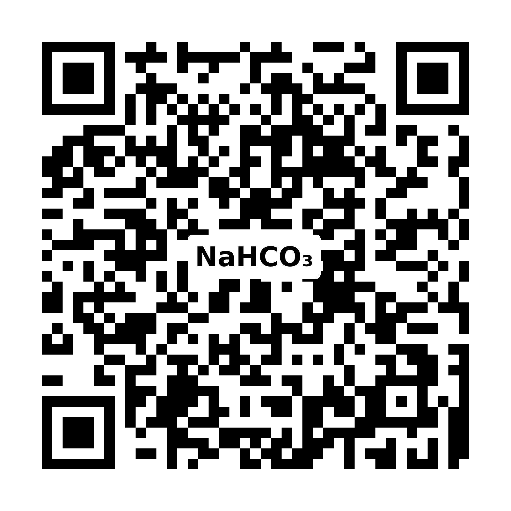

# 碳酸氢钠助手 · 手机版

供住院医师规范化培训学员在手机浏览器里打开试用的单页教学辅助。计算在本机完成，适合课堂和床旁示教时对照讨论。

## 使用边界

- 这是教学辅助，不是诊疗规范。
- 页面里的公式、阈值、预设病例和引用文案没有经过医学终审，不能用于个体处方或临床决策。
- 不上传患者数据，也不做持久化。页面不写入本地存储，也不向服务器提交内容。
- 真机 Safari、Android Chrome，以及手机相机或微信扫码，都还没有实测。

## 试用地址

https://lyhgxlbl-netizen.github.io/bicarbonate-mobile/

公开 HTTPS 已返回该页：体积 69200 字节，SHA-256 `0fcd11c88b36b4641f3c6f3d41e38095f7f6ea0126a5a57ee725435b98f95b07`，与仓库 `index.html` 一致。

## 二维码

中央字为 NaHCO₃，指向上面的试用地址。PNG、SVG 与说明按归档原字节放在 `qr/`。解码记录、纠错级别和「未做真机扫码」写在说明原文里，这里不另作医学或扫码结论。

- [下载 PNG](qr/碳酸氢钠助手-二维码.png)
- [下载 SVG](qr/碳酸氢钠助手-二维码.svg)
- [阅读说明](qr/说明.md)

这些文件进入 `main` 后，Pages 按同样路径提供：

- [PNG](https://lyhgxlbl-netizen.github.io/bicarbonate-mobile/qr/%E7%A2%B3%E9%85%B8%E6%B0%A2%E9%92%A0%E5%8A%A9%E6%89%8B-%E4%BA%8C%E7%BB%B4%E7%A0%81.png)
- [SVG](https://lyhgxlbl-netizen.github.io/bicarbonate-mobile/qr/%E7%A2%B3%E9%85%B8%E6%B0%A2%E9%92%A0%E5%8A%A9%E6%89%8B-%E4%BA%8C%E7%BB%B4%E7%A0%81.svg)
- [说明](https://lyhgxlbl-netizen.github.io/bicarbonate-mobile/qr/%E8%AF%B4%E6%98%8E.md)

## 文件

- `index.html`：现成单文件页面，按原字节放入。计算公式、阈值、预设病例和引用文案未改。
- `DESIGN.md`：版式与交互说明。其中的医学观察只是记录，不是审稿结论。
- `CHECKLIST.md`：先前交付时的验收记录，路径仍指向当时的工作目录。
- `qr/`：二维码 PNG、SVG 与 `说明.md`。
- `.nojekyll`：让 GitHub Pages 按静态文件原样提供，不经 Jekyll 处理。

## 托管

静态页从 `main` 分支根目录发布。
